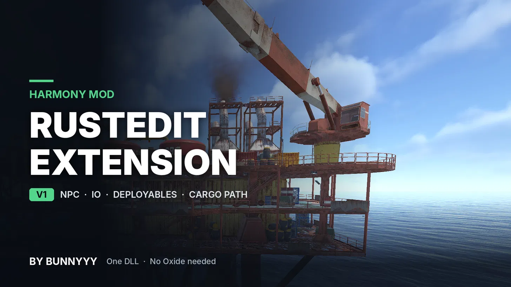

   

  <a href="https://github.com/Bunnyyy112/Harmony-RustEdit-Extension/releases/latest"><b>⬇️ DOWNLOAD LATEST RELEASE</b></a>

A Harmony mod that brings RustEdit custom map features to your server. **No Oxide or Carbon needed.** One DLL. Drop it in, start your server, done. No config files to edit.

Works with **RustEdit 1 and RustEdit 2** maps. The DLL checks your map on startup and uses the right one by itself.

## 🗺️ RustEdit 2 Maps
- Export with **Entities: In RustEdit data**. The "In the map" option leaves out all the IO wiring and NPC spawners
- Export **without a key**. Locked maps aren't supported
- RustEdit 1 maps work exactly like before
- Anything your RustEdit 2 map uses that isn't supported yet gets listed in console on startup
- **Indestructible** entities can't be damaged or picked up
- **Sign images** you put on signs in RustEdit 2 show in game
- Map signs can't be drawn on or picked up. Admins with god and fly on still can
- **Radiation zones** use your RustEdit 2 settings (tier, amount and falloff)

## 🧍 NPCs
- Spawns all the NPCs you placed with RustEdit NPC spawners and makes them act like rust ai npcs
- **They take cover:** shot, out of ammo or low on health, scientists run to real cover (crates, barricades, sandbags, tyres, lockers, rubble) and hide properly - like real rust npc's
- Crouch in cover, **peek up and shoot** when they have a clear shot, reload and heal behind cover
- Never run past you to find cover. No cover close by? They strafe and fight back
- Scientists carry **one medical syringe** and heal once. Don't let them use it and it's yours when they drop
- Hit an NPC and it comes for you - like rust's npc
- **Can't see you through deployables or glass**
- **Walk paths:** NPCs follow the RustEdit 2 walk paths and splines you gave them
- **No more floating:** NPCs keep their boots on the floor or prefab under them, walking or standing
- NPCs roam around their spawn like real Rust NPCs, walk back home if they wander off, and get reset if stuck
- NPCs can't walk through closed keycard / card room doors
- Turrets and Bradley ignore map NPCs
- Scientists have a **1 in 4 chance** to carry an **F1 grenade** and throw it once per life, just like old Rust

## 🚜 Bradley
- Bradley patrols your custom map
- Uses RustEdit 1 APC paths, RustEdit 2 APC paths or a `bradleypaths.json` file
- **Anti-stuck:** a Bradley that stops moving gets reset

## ⚡ IO
- Connects all your RustEdit IO wiring on server start
- Protects map IO from damage, pickup, looting and wire tool tampering
- Builds map elevators with floors and lift
- Elevator buttons move **one floor at a time**
- Numbers your custom apartments and links custom mailboxes to their rooms
- **Apartment guard:** pay the toll and the door opens for you and your team. It closes when you walk away and runs out on the timer
- **Master key break-in** works standing at the door or kneeling and cancels if you walk away or switch item
- Admin commands: `/showiowires` `/reloaddoors`

## 🚪 Doors
- No more map doors glitching when you spam E
- Door colliders move with the door, so no invisible walls
- No more getting pulled back when you brush the edge of a shut map door. Noclipping through one still gets caught so unlucky cheaters

## 🪑 Deployables
- Keeps your RustEdit deployables in place and respawns them if they go missing
- Respawns map vehicles, keycard spawners, loot boxes and animals
- Custom vending and loot profiles from RustEdit
- CH47 landing zones and prefab skins
- Admin commands: `/showlootspawns` `/showvendingspawns` `/showanimalspawns` `/showentityspawns`

## 🚢 Cargo Path
- Uses the custom cargo path you drew in RustEdit (RustEdit 1 path or RustEdit 2 ocean patrol)
- Cargo stops at the dock, then carries on (`cargoship.dock_time`)
- No path? Cargo works like normal Rust
- Admin command: `/showcargopath`

## 🚧 Not Supported Yet On RustEdit 2
RustEdit 2's own Cargo Stop tool (our cargo stop markers still work), loadouts, other custom entity settings, other trigger settings, maps over 6000 m, tropical setting, locked maps.

## 📦 Install
1. Put `Harmony.RustEdit.Extension.dll` in your server's `HarmonyMods` folder
2. Remove any old RustEdit / Harmony mods
3. Start your server and look for `HARMONY.RUSTEDIT.EXTENSIONV1 BY BUNNYYY` in console
4. You'll see `Map Type: RustEdit 1` or `Map Type: RustEdit 2` so you know which one it's using
